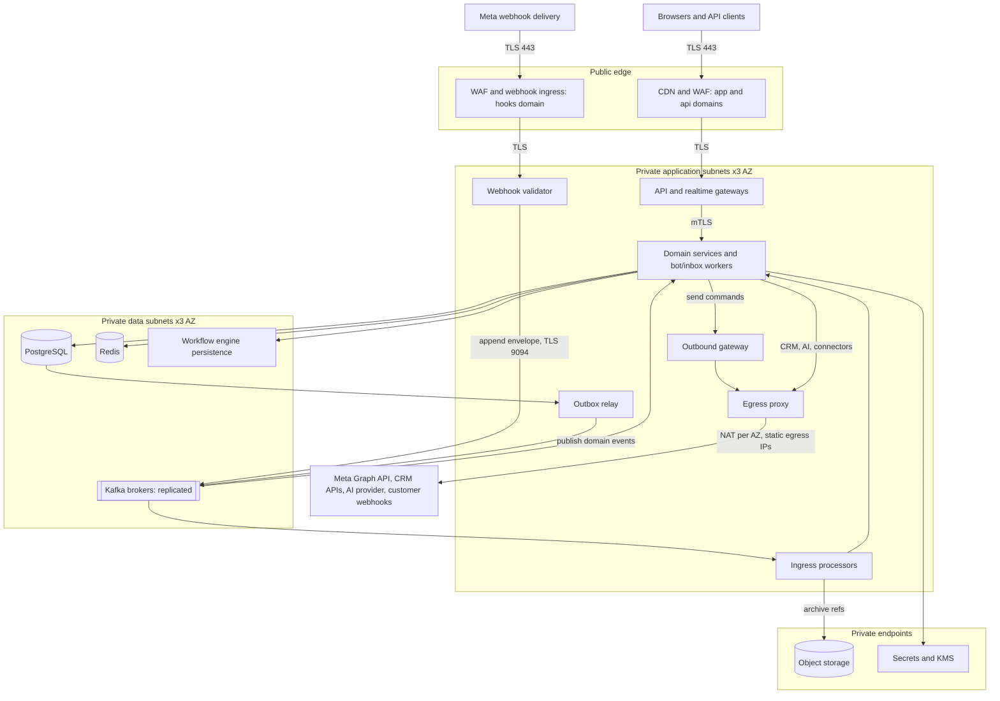
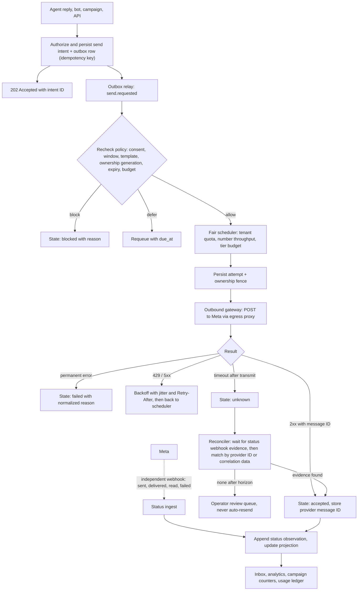
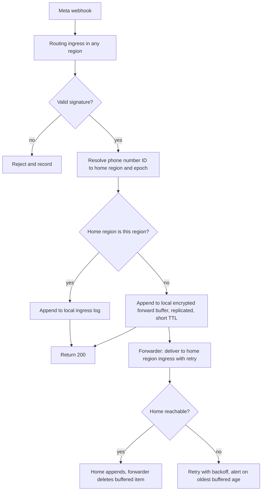
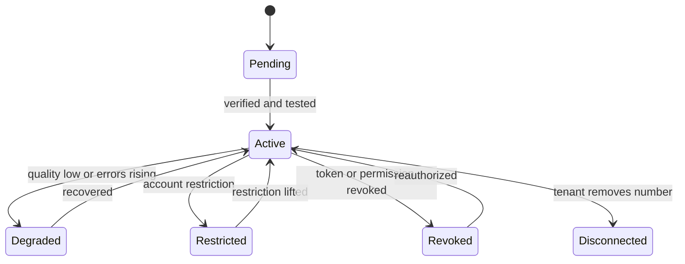
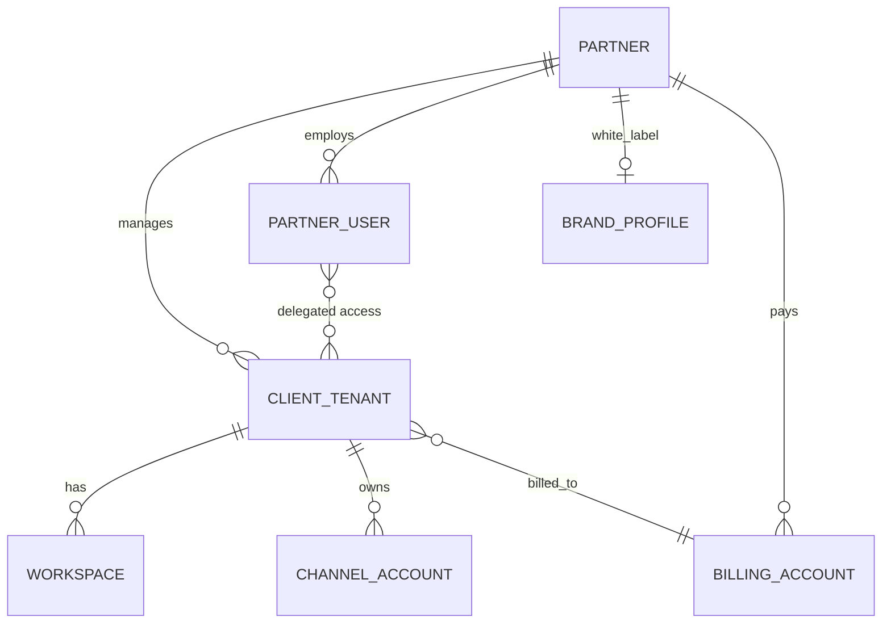
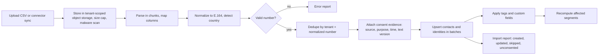

# Enterprise WhatsApp Platform Architecture: Revision 2

This revision keeps the original blueprint's sound core (transactional outbox, idempotency keys, single outbound gateway, "unknown" outcome after an ambiguous send, fenced writers, cells) and does three things: **corrects** diagrams and rules that were wired wrongly, **adds** capabilities that were missing, and defines a **minimum viable version** so a small team can ship before building the full enterprise footprint.

Sections keep the original numbering where they replace something (e.g. "Replaces §2"). Everything about Meta's platform (event names, limits, fields) must be verified against the live developer documentation before implementation.

## 0. Change Log

| # | Problem in v1 | Fix in v2 | Section |
|---|---|---|---|
| 1 | Figure 2 placed Kafka in the app subnets; no egress path to Meta; no publisher arrows | Redrawn: brokers in data subnets, explicit egress to Meta/CRM/AI, outbox relay drawn | 1 |
| 2 | Figure 6 showed the Meta status webhook as triggered by the adapter; only the happy path; "ambiguous" was a dead end | Redrawn with independent webhook, blocked/retry/unknown branches and a reconciler | 2 |
| 3 | Ingress log written before the conversation is known, yet partitioned by conversation | Two-stage partitioning: ingress keyed by phone number, then re-keyed by conversation | 3 |
| 4 | Cross-region webhook forwarding conflicted with "ack only after durable append" | Local durable forward buffer before ack, with drain and failure rules | 4 |
| 5 | Account health (tiers, quality) not modeled | Account health state, events, admission rules | 5 |
| 6 | Click-to-WhatsApp ads missing | Referral capture, trigger node, attribution | 6 |
| 7 | Flat tenancy | Partner / client hierarchy for agencies and resellers | 7 |
| 8 | No contact import or segmentation | Import pipeline, validation, tags, segments | 8 |
| 9 | Message types incomplete | Message type matrix and rendering rules | 9 |
| 10 | Agent tooling absent | Canned replies, labels, SLA timers, push | 10 |
| 11 | Scope too large for a first release | Minimum viable version with upgrade triggers | 11 |
| 12 | Invariants and tests did not cover the above | Added invariants and acceptance tests | 12 |

## 1. Corrected Network Topology (Replaces §2, Figure 2)

Corrections:

- **Kafka and the workflow store are data-tier resources**, reachable only from the application subnets.
- **Every external call goes through the egress proxy**, including the outbound gateway's calls to Meta. The proxy enforces the destination allowlist and SSRF rules, and the NAT gives customers static IPs to whitelist.
- **Publishing is drawn explicitly:** services write business rows plus an outbox row in Postgres; the outbox relay publishes to Kafka. Services never publish directly inside a business transaction.

## 2. Corrected Outbound Pipeline (Replaces §8, Figure 6)

The status webhook is **not** a reply to your request: Meta initiates it later, possibly out of order and possibly before your HTTP response is processed. Status ingest therefore tolerates receiving a status for a message whose provider ID has not been stored yet (park it briefly, then join).

## 3. Two-Stage Partitioning (Fixes an Ordering Gap in §7 and §9)

At webhook time the platform knows only the Meta phone number ID and WABA, not the conversation. So:

1. **Stage 1, ingress topic:** key = `phone_number_id`. Ordering here only preserves per-number arrival order and keeps a single busy tenant from being spread randomly.
2. **Stage 2, conversation topic:** the normalizer resolves tenant, contact, and conversation inside a transaction, assigns `aggregate_seq`, writes the outbox row, and the relay publishes to a topic keyed by `tenant_id + conversation_id`.
3. **Hot number risk:** a single very busy number is limited to one partition at stage 1. Size for it, and allow a sub-key (`phone_number_id` + hash of sender) if measurements show a bottleneck; per-conversation order is restored in stage 2 by `aggregate_seq`, not by stage 1 order.

Downstream consumers read only stage 2. Stage 1 is an internal durability buffer.

## 4. Cross-Region Webhook Routing (Replaces the routing paragraph in §4)

The rule "acknowledge only after durable acceptance" holds in every topology:

- **Ack rule:** return `200` only after the item is in the local ingress log *or* the local forward buffer. Never after an in-memory hand-off.
- **Residency:** the forward buffer holds message bodies briefly in a region that may not be the home region. Tenants with strict residency must use a region-specific webhook URL (Meta supports overriding the callback at the WABA or phone-number level; verify current support), which removes the buffer for them.
- **Failover:** during a placement epoch change, the forwarder re-resolves the destination on every attempt; buffered items are stamped with the epoch they were received under and rejected by a stale home region.
- **Duplicates:** forwarding retries create duplicates; the normalizer's provider-message-ID uniqueness handles them.

## 5. Account Health as First-Class State (New)

Add to the channel account record: `quality_rating`, `messaging_limit_tier`, `display_name_status`, `business_verification_status`, `account_review_status`, `last_health_event_at`.

**Inputs:** subscribe to the platform's account, phone-number-quality, and template-status webhook events (names and payloads to be verified), plus a scheduled pull to repair missed events.

**Effects on send admission:**

- **Daily unique-recipient budget** per number, counted in Redis with a rolling 24-hour window and reconciled against the tier; campaigns cannot be admitted beyond the remaining budget.
- **Quality drop:** automatically reduce campaign concurrency, pause new promotional campaigns on a flagged number, and alert the tenant with a plain explanation.
- **Template state change:** paused/rejected/disabled templates immediately block queued recipients (state `blocked_template`).
- **Restricted or disconnected account:** sends pause; inbox stays readable.

## 6. Click-to-WhatsApp Ads (New)

- **Capture:** inbound messages that originate from an ad carry referral data (ad/source identifiers and a click identifier; verify current field names). Persist it on the conversation as `entry_source`, `ad_id`, `click_id`, `first_referral_at`.
- **Trigger node:** add "Ad referral" to the trigger types with filters (specific ad, campaign, or any ad), so a flow can greet by product and qualify the lead.
- **Attribution:** link conversation, contact, and later conversion events (order created, form completed, tag applied) back to the ad and store them as analytics facts.
- **Feedback loop:** where Meta's conversion-reporting API for messaging is available to your integration, send qualified-lead and purchase events using the stored click identifier, through the standard connector framework with idempotency keys and consent checks.
- **Ad setup helper (optional):** a deep-link and pre-filled-message generator, plus a check that the number is active and its welcome flow is published.

## 7. Partner / Client Hierarchy for Agencies (Replaces the flat tenant in §5 and §10)

- **The client tenant remains the isolation boundary.** Partner staff reach a client only through an explicit, revocable, audited delegation with a role (viewer, agent, admin), never through a shared database scope.
- **Provider account ownership:** decide per client whether the WABA belongs to the client (recommended; portable) or to the partner. Record it, because it determines who can revoke tokens and who is billed by Meta.
- **White label:** brand profile (logo, colors, custom domain, sender email), with a separate hooks/API domain per partner if requested. Custom domains need certificate automation and host-header routing that never trusts the header for authorization.
- **Billing:** partner-level invoice with per-client line items; usage ledger rows carry both `client_tenant_id` and `billing_account_id`.

## 8. Contact Import, Validation, and Segmentation (New)

- **Consent at import:** the uploader must declare a permission basis per file or per row. Rows without one import as `unknown_consent` and are excluded from marketing sends.
- **Not-on-WhatsApp handling:** a failed send that Meta reports as an undeliverable/non-WhatsApp number marks the identity `whatsapp_unreachable`, suppresses repeated attempts, and is visible in the contact record and campaign report. (Do not pre-check numbers against Meta in bulk unless the current API terms allow it.)
- **Tags and custom fields:** typed fields (text, number, date, boolean, select) with schema per tenant.
- **Segments:** stored filter definitions evaluated at campaign freeze time; large segments are materialized in chunks. Static lists and dynamic segments are distinct.
- **Merge and delete:** verified merge only; deletion requests cascade per the retention workflow, including segment membership and import files.

## 9. Message Type Support Matrix (New)

| Type | Send | Receive | Notes |
|---|---|---|---|
| Text | Yes | Yes | Link preview optional |
| Media (image, video, audio, document, sticker) | Yes | Yes | Size and MIME limits per Meta; scan before display |
| Template (text, media, buttons) | Yes | n/a | Only way to open a conversation outside the service window |
| Interactive reply buttons | Yes | Button reply | Limits on button count and label length |
| Interactive list | Yes | List reply | Section and row limits |
| Call-to-action URL button | Yes | n/a | Domain must be allowed for tracking |
| Location | Yes | Yes | Coordinates stored; render map preview via privacy-safe tile service |
| Contacts card | Yes | Yes | Treat as untrusted data |
| Reaction | Yes | Yes | Attached to a message ID, not a new bubble |
| Reply-to context | Yes | Yes | Store `context.message_id` for threading |
| Product / catalog messages | Yes | Order | Requires catalog setup |
| WhatsApp Flows | Yes | Response | Separate definition and endpoint (see v1 §14, §18) |
| Unsupported / system | n/a | Yes | Store a placeholder; never drop |

Each type has a canonical internal schema plus a channel adapter that rejects unsupported combinations at flow-compile time, not at send time.

## 10. Agent Tooling (New)

- **Canned replies:** shared and personal, with variables (`{{contact.first_name}}`), per-team visibility, and a template-aware mode that inserts an approved template when the service window is closed.
- **Labels and notes:** conversation labels (tenant-defined), internal notes as a separate object type never sent to customers.
- **SLA timers:** per team/priority policy; timers start at inbound and pause during customer-wait states; escalation events go to supervisors. Timers are durable jobs with generation checks, not in-memory clocks.
- **Notifications:** web push and mobile push (APNs/FCM) via a notification service that receives only conversation IDs and short redacted previews; respects working hours and per-agent preferences; deduplicates when the agent is already active in the inbox.
- **Mobile clients:** same API and realtime contract as web; offline draft queue that submits with idempotency keys.
- **Supervisor tools:** live queue view, reassign, bulk close, and read-only "whisper" monitoring restricted by role and audited.

## 11. Minimum Viable Version (New, Recommended Starting Point)

Keep the invariants; defer the machinery.

| Concern | Start with | Upgrade trigger |
|---|---|---|
| Deployment | One region, one cell, managed containers or small Kubernetes | Customer residency requirement, or a tenant needing isolation |
| Message log | Postgres tables plus a transactional outbox and a Postgres-backed job queue (or a managed queue) | Sustained load or replay needs beyond the queue's limits; then add Kafka |
| Automation | Flow interpreter in workers with state in Postgres and durable timers via scheduled jobs | Very long-running or highly branching workflows; then adopt a workflow engine |
| Realtime | Server-sent events or WebSocket with Redis pub/sub | Connection counts beyond a few thousand per node |
| Analytics | Postgres aggregates and materialized views | Dashboard queries hurting transactional performance |
| AI | Draft mode only, retrieval on a Postgres vector extension | Evaluated quality supports auto-send |
| DR | Automated backups, tested restore, documented manual failover | Contractual RPO/RTO |
| Tenancy | Shared schema with `tenant_id` and row-level security | Dedicated-cell customers |

**Non-negotiable even in the MVP:** signature verification; durable ack before processing; inbound and outbound idempotency; single outbound gateway; `unknown` state and no blind resend; consent evidence; per-number rate limiting and tier budget; encrypted tokens; tenant isolation tests; account health state.

## 12. Added Invariants and Acceptance Tests

**Invariants**

- A `200` to Meta or a forward-buffer acknowledgment always follows a durable write.
- Conversation order is established by `aggregate_seq` in stage 2, never by ingress order.
- No campaign admission exceeds the number's remaining daily budget, and a health downgrade takes effect on already-queued recipients.
- Partner access to a client is delegated, audited, and revocable; it never bypasses tenant isolation.
- Imported contacts without a permission basis are never eligible for marketing sends.
- Ad-referral data is stored with the conversation and cannot be overwritten by later messages.

**Additional tests**

| Scenario | Pass condition |
|---|---|
| Status webhook arrives before the send response is stored | Observation is parked, then joined; final state correct |
| Home region unreachable during forwarding | Buffered, acknowledged once durable, drained after recovery, no loss or duplicate effect |
| Quality rating drops mid-campaign | Concurrency reduced, new promotional admissions paused, tenant alerted |
| Template paused while recipients are queued | Remaining recipients blocked with `blocked_template` |
| Daily tier budget exhausted | Campaign pauses with a clear reason and resumes next window |
| CSV with mixed valid/invalid numbers and no consent column | Valid rows imported as `unknown_consent`, invalid rows reported, no marketing eligibility |
| Partner delegation revoked during an active session | Realtime subscriptions closed; subsequent API calls return 403 |
| Ad-referral conversation with later organic messages | Original referral preserved; attribution correct |
| Hot phone number at stage 1 | No cross-conversation reordering after stage 2 |

## 13. Still Open (Confirm Before Building)

Meta partner eligibility and required approvals; the current messaging-limit model, throughput entitlements, and webhook event names; whether the per-WABA callback override fits your residency plan; whether your commercial model bills Meta charges directly or through you; and which markets and currencies you will launch in. These change details in sections 4 to 6 and the billing design, not the overall structure.
